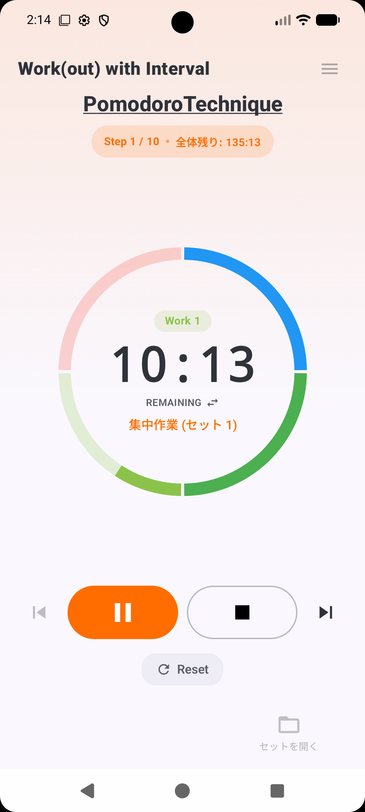
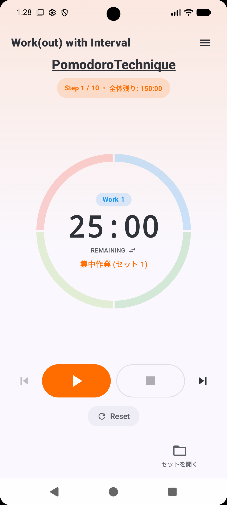
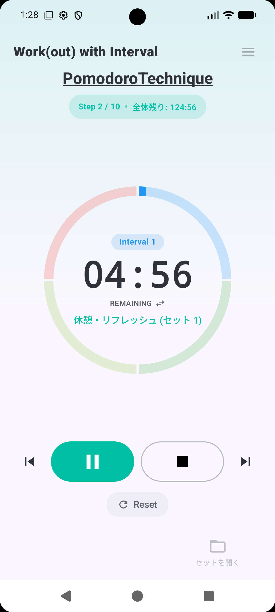
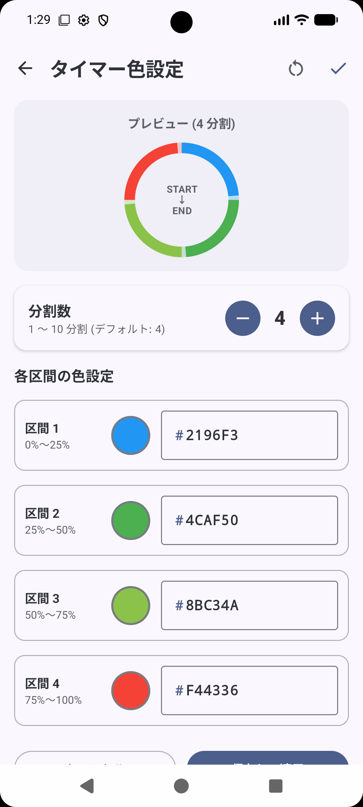
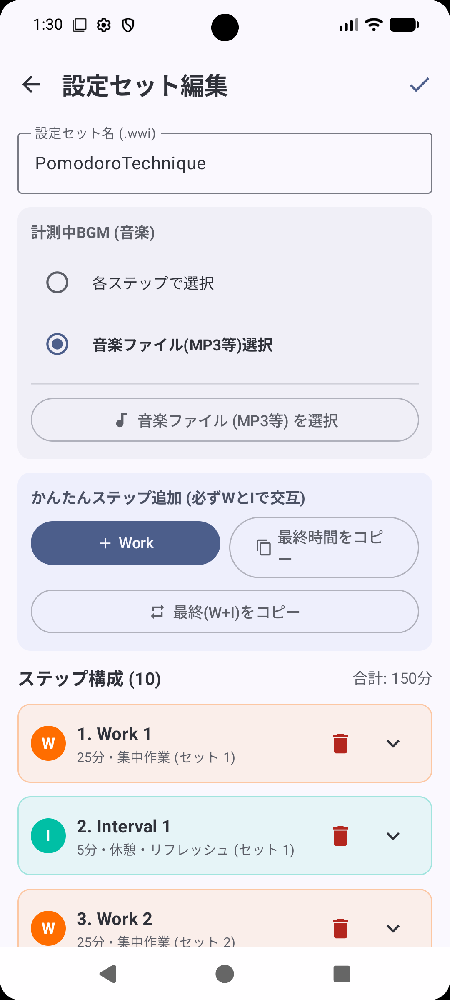
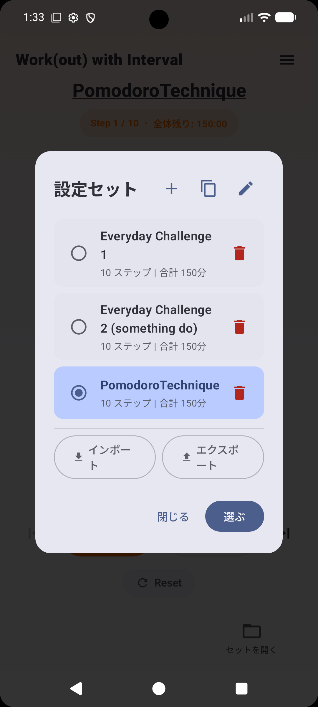
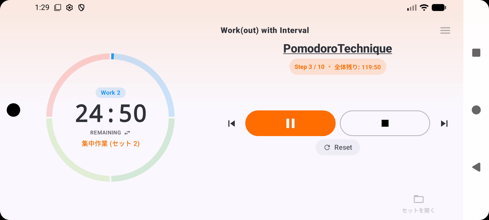

# Work(out) with Interval 公式ユーザーガイド（取扱説明書）

本アプリ **「Work(out) with Interval」** は、デスクワークや勉強のための**ポモドーロタイマー**から、筋トレ・HIIT・タバタトレーニングといった**フィットネスタイマー**まで、集中と休憩を繰り返すすべてのアクティビティをサポートする多機能インターバルタイマーです。

---

## 目次
1. [主な特徴](#1-主な特徴)
2. [基本画面と操作方法](#2-基本画面と操作方法)
3. [タイマーのカスタマイズ](#3-タイマーのカスタマイズ)
   - [タイマー円の色設定（分割カラー）](#タイマー円の色設定分割カラー)
   - [背景色（テーマカラー）設定](#背景色テーマカラー設定)
4. [設定セット（プリセット）の作成と管理](#4-設定セットプリセットの作成と管理)
   - [かんたんステップ追加](#かんたんステップ追加)
   - [各ステップの詳細設定](#各ステップの詳細設定)
   - [BGMとアラーム音の設定](#bgmとアラーム音の設定)
   - [エクスポートとインポート（バックアップ・共有）](#エクスポートとインポートバックアップ共有)
5. [横画面（タブレット・スタンド設置）での活用](#5-横画面タブレットスタンド設置での活用)
6. [マニュアル用スクリーンショット撮影指示書](#6-マニュアル用スクリーンショット撮影指示書)

---

## 1. 主な特徴

- **集中（Work）と休憩（Interval）の自動ループ**: 交互に設定されたステップをスムーズに進行。
- **直感的な円形秒時計**: 進行度合いに応じて色が変化するマルチセグメントリング。
- **BGM連続再生**: 端末内のお好きな音楽（MP3等）をBGMに設定可能。ステップをまたいで途切れず通し再生＆止められるまでループ再生に対応。
- **自動遷移OFFモード**: 各ステップ終了時に自動で次に進まず、準備ができるまで待機＆アラームを鳴らし続けることが可能。
- **完全オフライン＆安心設計**: 外部サーバーへの個人情報やデータ送信は一切ありません。

---

## 2. 基本画面と操作方法

### メインタイマー画面の構成
- **最上部**: アプリ名（左）と **ハンバーガーメニュー［≡］（右・設定）**
- **プリセット名**: 現在選択されている設定セットの名称（下線付き）
- **ステップ進捗バッジ**: 「Step X / Y • 全体残り: MM:SS」
- **中央円形タイマー**:
  - ステップ種別バッジ（「Work」または「Interval」、あるいはカスタム名称）
  - デジタル時間表示（**タップで「残り時間」と「経過時間」を切替**）
  - ステップメッセージ（水分補給や腕立てなど）

- **操作コントロールボタン**:
  - `|◁` **前のステップ**: 1つ前のステップに戻る
  - `▷` / `||` **スタート / 一時停止**: タイマーの開始・ポーズ
  - `□` **ストップ**: 一時停止またはアラーム消音
  - `▷|` **次のステップ**: 次のステップへスキップ
  - **Reset**: 最初のステップの開始状態に戻す
- **最下部**: **［セットを開く］**（右寄せ配置）

---

## 3. タイマーのカスタマイズ

### タイマー円の色設定（分割カラー）
画面右上のハンバーガーメニュー［≡］ ＞ **［タイマー色設定］** から設定します。
1. **分割数の変更**:
   - `−` / `＋` ボタンで円の分割数を **1 〜 10 分割** まで調整できます（デフォルト: 4分割）。
2. **各区間の色設定**:
   - 各区間の「〇」カラーアイコンをタップするとカラーピッカーが開き、パレット選択やRGBスライダー、数値入力で好みの色に調整できます。
   - `#000000` 形式のカラーコードを直接入力することも可能です。
3. **プレビューと保存**:
   - 画面上部のミニタイマーで色変化を確認し、**［保存して適用］** をタップします。

### 背景色（テーマカラー）設定
画面右上のハンバーガーメニュー［≡］ ＞ **［背景色設定］** から設定します。
- **Work（作業）の背景色**: 集中中の背景グラデーションとスタートボタン色（初期値: オレンジ `#FF6D00`）
- **Interval（休憩）の背景色**: 休憩中の背景グラデーションとスタートボタン色（初期値: グリーン `#00BFA5`）
- 各色をタップして好みのカラーを選び、**［保存して適用］** をタップすると、即座に画面全体に反映されます。

---

## 4. 設定セット（プリセット）の作成と管理

画面右下の **［セットを開く］** をタップすると、設定セット一覧ダイアログが表示されます。
- **新規作成（＋）**: 新しいタイマー構成を作成します。
- **コピー**: 選択中のセットを複製して新しいセットを作成します。
- **編集（鉛筆アイコン）**: ステップ構成やBGMを編集します。
- **選ぶ**: 選択したセットをタイマーに適用します。

### かんたんステップ追加
編集画面では、以下のボタンで手早くセットを組み立てられます：
- **［Work］ / ［Interval］**: 交互に新しいステップを1つ追加します。
- **［最終時間をコピー］**: 直前のステップと同じ時間を維持したまま、交互の種別で追加します。
- **［最終(W+I)をコピー］**: 直前の「Work ＋ Interval」の1セット丸ごと末尾に追加します（セット数を増やしたい時に便利です）。

### 各ステップの詳細設定
各ステップのカードをタップして展開すると、以下の詳細項目を設定できます：
- **ステップ名**: 例「スクワット」「集中作業 1」
- **時間（分・秒）**: 0分1秒〜自由に入力可能（空欄で入力後、別項目へ移動すると自動で0補正されます）
- **画面表示メッセージ**: タイマー中央に表示されるメモ（例「水分補給」「フォーム意識」）
- **次のステップへ自動遷移**:
  - **ON**: 時間が来たらアラームを鳴らして自動で次のステップを開始します。
  - **OFF**: 時間が来たらアラームを鳴らし続け、手動でストップまたは次を開始するまで待機します。
- **終了時バイブレーション**: 終了時に端末を振動させるかを切り替えます。
- **終了音**: ベル音、チャイム、電子ビープ音、端末内の音声（MP3等）、なし（無音）から選択できます。

### BGMとアラーム音の設定
- **計測中BGMの選択**:
  - **「音楽ファイル(MP3等)選択」**: 全体共通のBGMを設定します。ステップをまたいでも曲は頭出しされず、**全体を通して途切れず再生**され、終了までループします。
  - **「各ステップで選択」**: 各ステップカードごとに異なる音楽ファイルを指定できます。
- **音量スライダー**: BGMの音量をステップごと、または全体で細かく微調整できます。

### エクスポートとインポート（バックアップ・共有）

- **エクスポート**: 作成した設定セットを `.wwi` 形式のファイルとして端末内やGoogleドライブ等に保存できます。
- **インポート**: 保存した `.wwi` ファイルを読み込み、即座にアプリに復元・追加できます。友達への共有や機種変更時のデータ移行に活用できます。

---

## 5. 横画面（タブレット・スタンド設置）での活用

スマートフォンを横向きに倒すと、自動的に**横画面専用レイアウト**に切り替わります：
- **左側**: 大きく見やすい円形秒時計（デスクから離れていても残り時間が一目で分かります）。
- **右側**: タイトル、ステップ進捗、操作ボタン、設定セットメニューを機能的に配置。
- スマートフォンスタンドに置いて作業するデスクワーカーや、ジム・ヨガマットの前に端末を横置きしてトレーニングする方に最適です。
